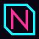

# Neonboard

A fast, private, cyberpunk-styled task tracker that runs entirely in your browser. No server, no sign-up, no dependencies.

---

## Overview

Neonboard brings tasks, projects, a calendar, timers and recurring routines together in one dark, neon-accented interface. Everything is stored locally in your browser, so it works offline and your data never leaves your device.

It is built with plain HTML, CSS and vanilla JavaScript, with no framework, package manager or build step.

## Features

- **Dashboard** with today's tasks, overdue items, upcoming deadlines, routines due today and a weekly completion chart.
- **Tasks** with priority (high, medium, low), status (to do, in progress, done), due dates, project assignment, filtering, sorting and search.
- **Projects** with progress tracking and a **Kanban board**. Drag cards between columns, or use the move buttons for keyboard-only control.
- **Calendar** month view showing the tasks due on each day.
- **Timers** to track time spent, with play, pause and reset.
- **Routines** for recurring habits on the days you choose, with a completion grid and streak counter.
- **Customization:** four accent colors (cyan, magenta, amber, mint), optional scanlines and glow, reduced-motion mode, 12 or 24-hour clock and a configurable first day of the week.
- **Backup and restore:** export all data to JSON and import it back at any time.
- **Accessible by design:** skip link, labelled controls, keyboard-operable interface and a reduce-motion setting.

## Keyboard shortcuts

| Key | Action                |
| --- | --------------------- |
| `/` | Focus the search box  |
| `n` | Create a new task     |
| `Esc` | Close the open dialog |

## Getting started

No installation is needed.

```bash
git clone <your-repository-url>
cd neonboard
```

Open `index.html` in a modern browser, or serve the folder locally:

```bash
python3 -m http.server 8000
```

Then visit http://localhost:8000.

## Project structure

```
neonboard/
├── index.html    # App shell: sidebar, top bar, view container and dialog
├── styles.css    # Theme tokens, layout, components and animation
├── app.js        # State and storage, views, modals, actions and routing
├── logo.svg      # Brand logo
├── favicon.svg   # Browser tab icon
└── README.md
```

`app.js` is organized into helpers, state and storage, domain helpers, views, modals, actions and events, and boot.

## Data and privacy

- All data is saved to your browser's `localStorage` under the key `neonboard.v1`. Nothing is sent to a server.
- Clearing site data or switching browsers removes your data, so use **Account → Export backup** regularly.
- Imported and stored data is validated before use.
- The only external request is Google Fonts (Chakra Petch and Share Tech Mono). The interface falls back to system fonts if they cannot load.
- Upgrading from the earlier Nightdesk build? Existing data is migrated automatically on first load.

## Customization

Colors, spacing and fonts are CSS custom properties at the top of `styles.css`, including the cyan and magenta neon palette, so you can re-theme the app by editing a few values. Default accent, scanlines, glow, motion and clock preferences can also be changed in the in-app settings.

## Browser support

Current versions of Chrome, Edge, Firefox and Safari.

## Contributing

Issues and pull requests are welcome. For larger changes, please open an issue first to discuss the proposal.

1. Fork the repository
2. Create a branch (`git checkout -b feature/your-feature`)
3. Commit your changes
4. Push the branch and open a pull request

## License

[Add your chosen license here, for example MIT, and include a `LICENSE` file.]
